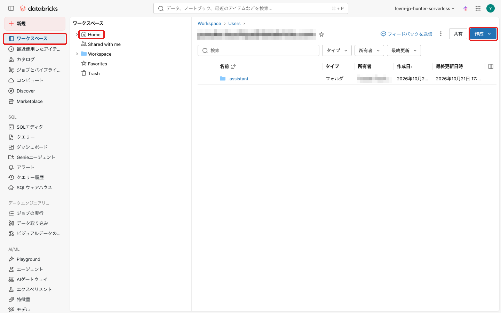
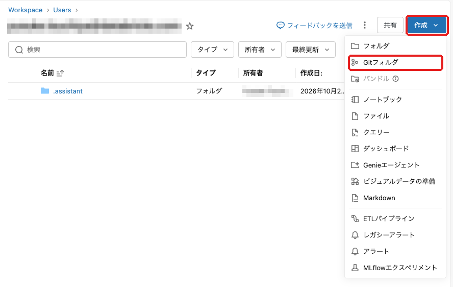
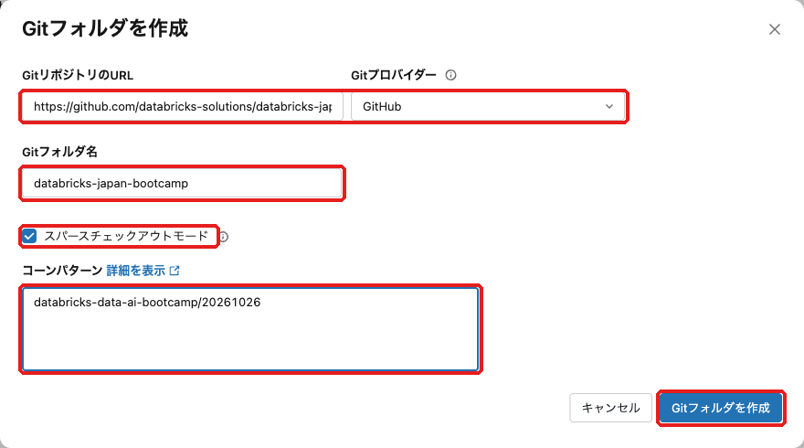
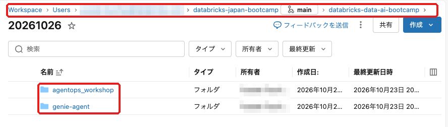

# Gitフォルダのセットアップ手順
ハンズオンで使うノートブックなどの資材を、Databricks ワークスペースに取り込む手順をご案内します。  
本リポジトリのうち `databricks-data-ai-bootcamp/20261026` フォルダだけを、Gitフォルダとしてワークスペースにクローンします。  
不明点がある場合は、遠慮なく講師にお尋ねください。

> 画面は言語設定が日本語の例です。英語表示の場合は、[日本語|English] の English 側の表記を目印にしてください。  
> 言語は [設定|Settings] > [環境設定|Preferences] > [言語|Language] で変更できます。

## Step 1: ホームフォルダを開く
1. **画面左のメニューから [ワークスペース|Workspace] を選択**
2. **[Home] を選択**
    - ご自身のホームフォルダ（`/Users/<ご自身のメールアドレス>`）が表示されます
3. **画面右上の [作成|Create] をクリック**

 

## Step 2: Gitフォルダの作成を選ぶ
- [作成|Create] のメニューから [Gitフォルダ|Git folder] を選択

 

## Step 3: リポジトリ情報の入力
以下の設定でGitフォルダを作成してください。

| 設定項目 | 設定値 |
|---------|-------|
| GitリポジトリのURL | `https://github.com/databricks-solutions/databricks-japan-bootcamp.git` |
| Gitプロバイダー | `GitHub` |
| Gitフォルダ名 | `databricks-japan-bootcamp` |
| スパースチェックアウトモード | ✓（チェック） |
| コーンパターン | `databricks-data-ai-bootcamp/20261026` |

- URL を入力すると、[Gitプロバイダー] と [Gitフォルダ名] は自動で入ります。上の表と同じになっていることを確認してください
- [スパースチェックアウトモード] にチェックを入れると、[コーンパターン] の入力欄が表示されます
- 入力できたら [Gitフォルダを作成|Create Git folder] をクリックします

 

## Step 4: 作成結果の確認
作成が終わると、Gitフォルダ `databricks-japan-bootcamp` が開きます。  
`databricks-data-ai-bootcamp` > `20261026` の順に開き、次の2つのフォルダがあれば完了です。

- `agentops_workshop`
- `genie-agent`

 

以上でGitフォルダのセットアップは完了です。

## うまくいかない場合
- **同じ名前のフォルダがすでにあると表示される**  
  以前のハンズオンで同じリポジトリをクローンしている可能性があります。[Gitフォルダ名] を `databricks-japan-bootcamp-20261026` などに変えて作成してください。
- **`20261026` フォルダが見当たらない**  
  [コーンパターン] の入力ミスが考えられます。作成したGitフォルダを削除し、`databricks-data-ai-bootcamp/20261026` を入力し直して作成してください。
