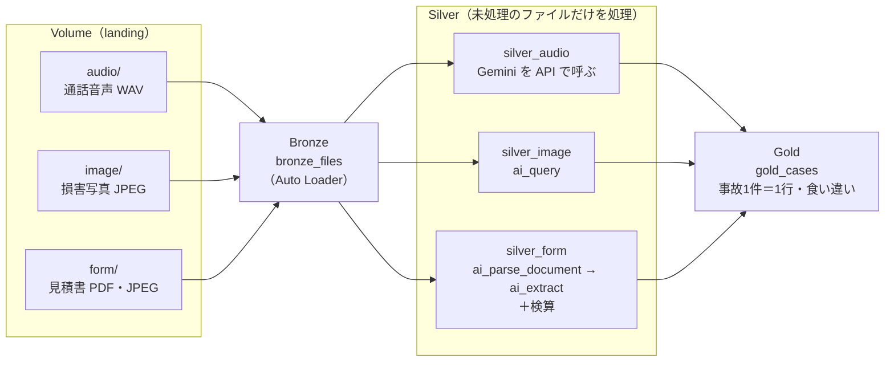

# 概要

音声・画像・帳票という形式の違う非構造化データを、Databricks 上で **ひとつのパイプライン** で処理し、分析や業務に使えるデータにするハンズオンです。

> **このハンズオンで持ち帰ること**
> 1. **流れは共通**：形式が違っても、共通の流れ（取り込む → AI で取り出す → 確かめる → つなぐ）で処理し、使えるデータにできる。形式ごとに違うのは「AI で取り出す」に使う手段だけ
> 2. **そのまま運用に乗る**：新しく届いたファイルだけを処理する作り（増分処理）にしておけば、処理済みのファイルにもう一度課金せず、同じノートブックをそのままジョブにして自動で回せる

題材は損害保険の事故受付です。事故1件（受付番号 `case_id`）ごとに、事故受付の **通話音声**・損害箇所の **写真**・修理工場の **見積書** が届きます。3つから取り出した内容を事故1件＝1行のテーブルにまとめ、1つの形式だけでは分からない食い違い（申告と写真で損傷の位置が違う、軽い接触という申告なのに見積が高額、など）を見つけます。

| # | ノートブック | 流れのどこか | 内容 | 時間の目安 |
|---|---|---|---|---|
| 0 | `00_setup` | — | 自分のスキーマと Volume を作り、1回目のサンプルデータ（case_01〜05）を置く | 5分 |
| 1 | `01_bronze_ingest` | 取り込む | 3形式のファイルを Auto Loader で1つのテーブルに取り込む | 8分 |
| 2 | `02_silver_audio` | 取り出す | 通話音声を Gemini に直接入力し、申告内容を JSON で受け取る | 14分 |
| 3 | `03_silver_image` | 取り出す | 損害写真から、損傷の位置・部位・程度を `ai_query` で取り出す | 12分 |
| 4 | `04_silver_form` | 取り出す・確かめる | 見積書を `ai_parse_document` → `ai_extract` で読み、計算の検算で人が確認すべき見積書を振り分ける | 16分 |
| 5 | `05_gold_join` | つなぐ | 3つを `case_id` でつなぎ、食い違いを見つける | 15分 |
| 6 | `06_add_new_files` | 運用に乗る | 2回目のサンプルデータ（case_06・07）を置き、01〜05 をもう一度実行して、新しい2件だけが処理されることを確かめる | 10分 |
| 付録 | `appendix_evaluation` | 確かめる | 見積書から取り出した値を正解データと突き合わせ、項目ごとの正解率を出す | — |

説明に沿って、00 から順にノートブックのセルを上から実行してください。`_config` は各ノートブックが読み込む共通設定で、単体では実行しません。

## 構成図

## 形式ごとの処理手段と課金

| 形式 | 手段 | 課金 |
|---|---|---|
| 音声 | 基盤モデル API を Python から呼ぶ（`databricks-gemini-3-1-pro`）。SQL の `ai_query` に渡せるファイルは画像（JPEG/PNG）だけのため | トークン課金 |
| 画像 | `ai_query`（`files => content`、`responseFormat` で JSON スキーマを指定。`databricks-gemini-3-5-flash`） | バッチ推論の対応モデルを呼ぶため、バッチ推論として時間課金。対応モデルは [ai_query によるバッチ推論](https://docs.databricks.com/aws/ja/large-language-models/ai-query) を参照 |
| 帳票 | [`ai_parse_document`](https://docs.databricks.com/aws/ja/sql/language-manual/functions/ai_parse_document) → [`ai_extract`](https://docs.databricks.com/aws/ja/sql/language-manual/functions/ai_extract)（version 2.1） | AI Functions の課金（ページ数・入力件数に応じた DBU） |

`ai_query` は、呼び出すモデルによって課金が変わります（バッチ推論の対応モデルなら時間課金、それ以外はトークン課金）。また、`responseFormat` に対応しないモデルもあります。モデルを替えるときは、[構造化出力](https://docs.databricks.com/aws/ja/machine-learning/model-serving/structured-outputs) の対応状況もあわせて確かめてください。

## 前提条件

- Unity Catalog が有効なワークスペース。動作確認は AWS 東京リージョン（`ap-northeast-1`）で行っています
- サーバレスのノートブックが使えること。ノートブックの環境は既定のままで構いません（環境バージョン 1 と 4 で、通しの動作を確認しています）
- [パートナーが提供する AI 機能](https://docs.databricks.com/aws/ja/databricks-ai/partner-powered) が有効であること（Gemini を使うため）
- 次の基盤モデルを呼び出せること
  - `databricks-gemini-3-1-pro`（音声の入力。[音声・動画モデルの照会](https://docs.databricks.com/aws/ja/machine-learning/model-serving/query-audio-video-models)）
  - `databricks-gemini-3-5-flash`（画像の入力）
- AI Functions（`ai_query`・`ai_parse_document`・`ai_extract`）が使えるリージョンであること（[リージョン別の機能の対応](https://docs.databricks.com/aws/ja/resources/feature-region-support)）
- スキーマを作れるカタログ（`USE CATALOG` と `CREATE SCHEMA` の権限）。既定は `workspace`

## 事前準備

1. このリポジトリをワークスペースに [Git フォルダ](https://docs.databricks.com/aws/ja/repos/git-operations-with-repos) として取り込みます。ノートブックは、同じフォルダの `data/` からサンプルデータを読みます。
2. 使うカタログが `workspace` 以外のときは、`notebooks/_config` の `DEFAULT_CATALOG` を書き換えます。スキーマは、ログインしているユーザー名から自動で作ります（例：`yamada.taro@example.com` → `ws_yamada_taro`）。

`_config` は読み込まれるたびに、ノートブックの環境で `ai_parse_document` が使えるかを確かめます。公式ドキュメントでは `ai_parse_document` の要件はサーバレス環境のバージョン 3 以上とされています。使えない環境のときは、その場で止まって案内が表示されるので、右側の **環境** パネルの **基本環境** で新しいバージョンを選び、**適用** してから実行し直してください（[サーバーレス環境の設定](https://docs.databricks.com/aws/ja/compute/serverless/dependencies)）。

最初からやり直すときは、`00_setup` の `RESET = True` にして実行すると、作ったテーブル・置いたファイル・処理済みの記録を消します。

## 発展：ジョブで自動実行する

01〜05 のノートブックは、そのままジョブのタスクにできます（01 →〔02・03・04 を並列〕→ 05）。`landing/` に [ファイル到着トリガー](https://docs.databricks.com/aws/ja/jobs/file-arrival-triggers) を付けると、ファイルが届くたびに自動で実行されます。

- ファイル到着トリガーが動くかは、Volume がある外部ロケーションの設定（ファイルイベント）によって変わります。事前に動作を確かめてください。

## サンプルデータ

`data/` のサンプルデータ（7案件分の通話音声・損害写真・修理見積書・見積書の正解データ）は、本ハンズオンのために作成したものです。登場する会社名・人名・修理工場・番号はすべて架空です。音声とフォントのクレジットは [data/CREDITS.md](data/CREDITS.md) を参照してください。音声を再配布するときは、このクレジットを添えてください。
